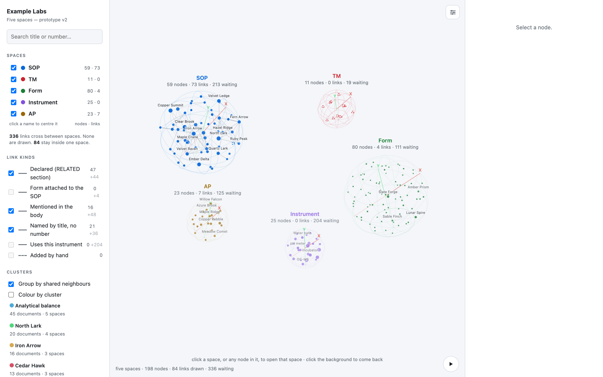
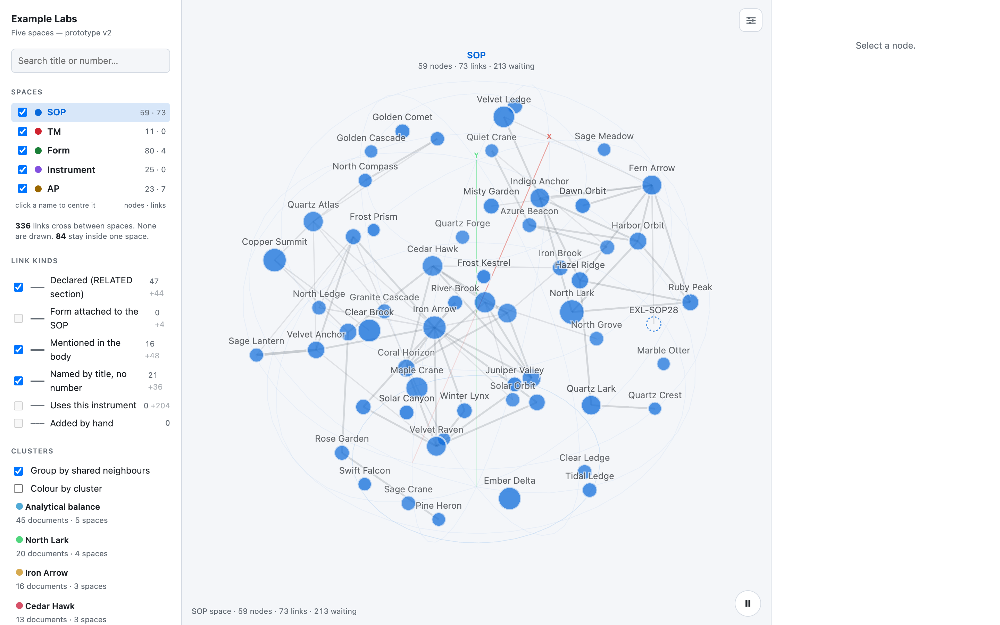
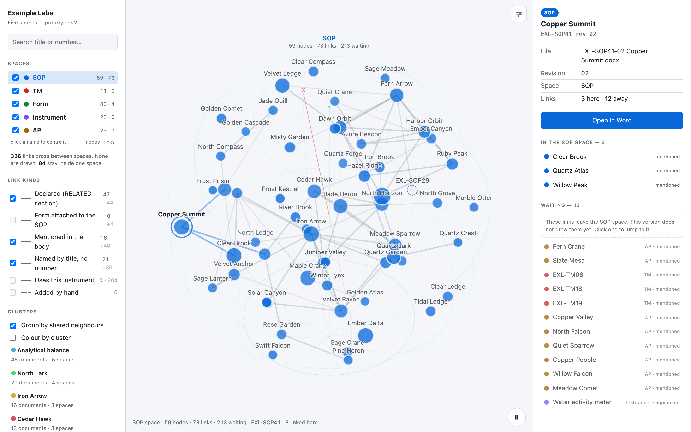
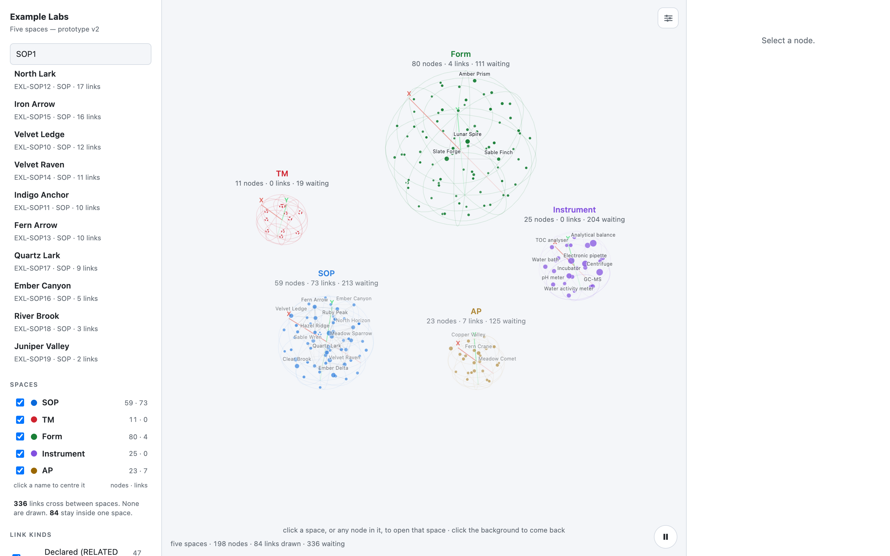
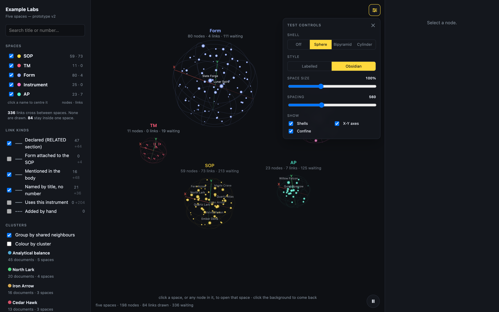
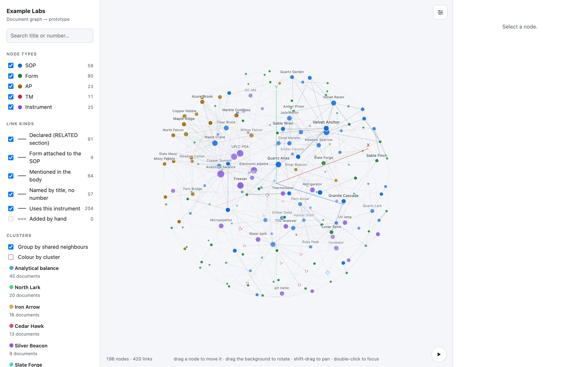

# SOP Node Graph

An interactive 3D map of a laboratory's quality management system. Each standard operating procedure (SOP), form, analytical procedure, test method and instrument is a node. Each reference between them is a link.



> **All data in this repository is anonymised.** "Example Labs" is fictional. The `EXL-` document numbers stand in for the real numbering, every document title is a randomly generated two-word name such as *Copper Summit*, and the quoted text that supports each link has been withheld. The shape of the graph (198 nodes, 441 links) is real. The names are not.

## Quick start

No install and no server. The viewers are single HTML files with the graph embedded.

1. Clone or download the repository.
2. Open `viewer_v2.html` in Chrome, Edge, Firefox or Safari.

`viewer.html` is the earlier single-space prototype. It opens the same way.

## The two viewers

| File | What it shows |
|---|---|
| `viewer_v2.html` | **Five spaces.** One sphere per node type. Only links that stay inside a space are drawn. Links that cross spaces are listed as "waiting" in the detail panel. |
| `viewer.html` | **One space.** Every node and every link in one volume. |

## Navigating `viewer_v2.html`

### 1. The overview

The page opens on five spaces: **SOP**, **Form**, **AP** (analytical procedure), **TM** (test method) and **Instrument**. Each label shows its node count, the links drawn inside it and the links "waiting" to other spaces.

- **Drag the background** to rotate.
- **Shift-drag** to pan.
- **Scroll** to zoom.
- **Space bar** or the ▶ / ❚❚ button at the bottom right pauses the slow rotation.

### 2. Open a space

Click a sphere, or click its name under **Spaces** in the left panel, to open that space. It fills the view, and its documents are labelled.



Click the background or press **Esc** to return to the overview.

### 3. Select a document

Click any node. The right panel shows:

- the title, document number, revision and file name
- **In the … space**: the documents it links to in the same space, strongest link first
- **Waiting**: links to documents in other spaces. Click one to jump to it.
- **Open in Word**: opens the source `.docx` when the viewer is built on a machine that has the documents. In this public build it does nothing.

Drag a selected node to move it. Its neighbours follow.



### 4. Search

Type a title or a number, such as `SOP1` or `Copper`, in the search box at the top left. Click a result to select it.



### 5. Filter

The left panel controls what is drawn:

- **Spaces**: show or hide each node type.
- **Link kinds**: show or hide each kind of evidence. The two numbers are links drawn inside a space and links waiting across spaces.

  | Kind | Meaning |
  |---|---|
  | Declared | named in the document's *Related procedures / forms* section |
  | Form attached to the SOP | the SOP carries the form as an attachment |
  | Mentioned in the body | the document number appears elsewhere in the text |
  | Named by title, no number | another document's title appears without its number |
  | Uses this instrument | the document names an instrument |
  | Added by hand | a link asserted by a person, drawn dotted |

- **Clusters**: *Group by shared neighbours* pulls together documents that share many neighbours even when neither names the other. *Colour by cluster* recolours nodes by group. Each cluster is named after its most connected document. Click the name to open that document.
- **View**: rotation, flatten to 2D, labels, and hiding nodes with no link.
- **Link opacity**: a slider for dense areas.
- **Reset view**: returns the camera and selection to the start.

### 6. Test controls and the Obsidian style

The ☰ button at the top right of the canvas opens **Test controls**:

- **Shell**: the shape drawn around each space (off, sphere, bipyramid, cylinder).
- **Style**: *Labelled* (light) or *Obsidian* (dark, fluorescent).
- **Space size** and **Spacing**: the size of each space and the distance between them.
- **Show**: shells, X-Y axes, and whether nodes are confined to their space.



## `viewer.html`: one space

Every node and link sits in one sphere. The controls are the same, and in addition:

- **drag a node** to move it
- **double-click** to focus on a node



## Repository layout

```
viewer_v2.html            five-space viewer (built, open directly)
viewer.html               single-space viewer (built, open directly)
graph.json                the anonymised graph: nodes, links, evidence kind
CONTEXT.md                the agreed word list for the project
research/                 framework and Windows build research (Tauri v2)
tools/
  extract_graph.py        builds graph.json from folders of .docx/.xlsx documents
  docx.py                 reads document bodies, excluding headers and footers
  reconcile.py            checks the folders against the tracking logs
  make_viewer.py          builds the two viewers from graph.json
  viewer_template.html    template for viewer.html
  viewer_v2_template.html template for viewer_v2.html
  check_viewer.js         smoke test for viewer_v2.html (Node, no dependencies)
docs/screenshots/         the images in this README
```

## Rebuilding

The viewers are built from `graph.json`:

```
python3 tools/make_viewer.py
node tools/check_viewer.js
```

To build a graph from your own documents, point the extractor at three folders of SOPs, forms and methods. It expects document numbers in the form `EXL-SOP10-03`. Change the `DOC` pattern in `tools/extract_graph.py` to match your own numbering.

```
python3 tools/extract_graph.py <sop-folder> <forms-folder> <methods-folder>
```

Note that `make_viewer.py` writes each document's absolute path into the page so that **Open in Word** works. Don't publish a viewer built from private documents.
